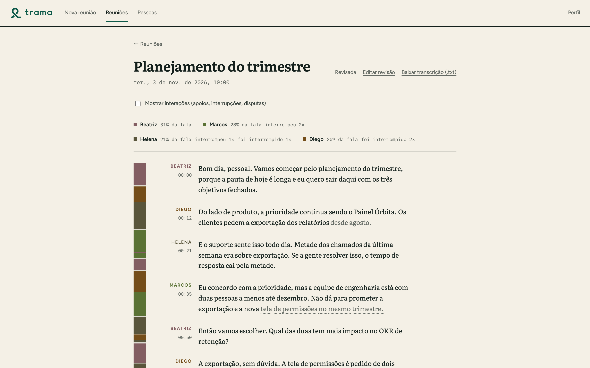
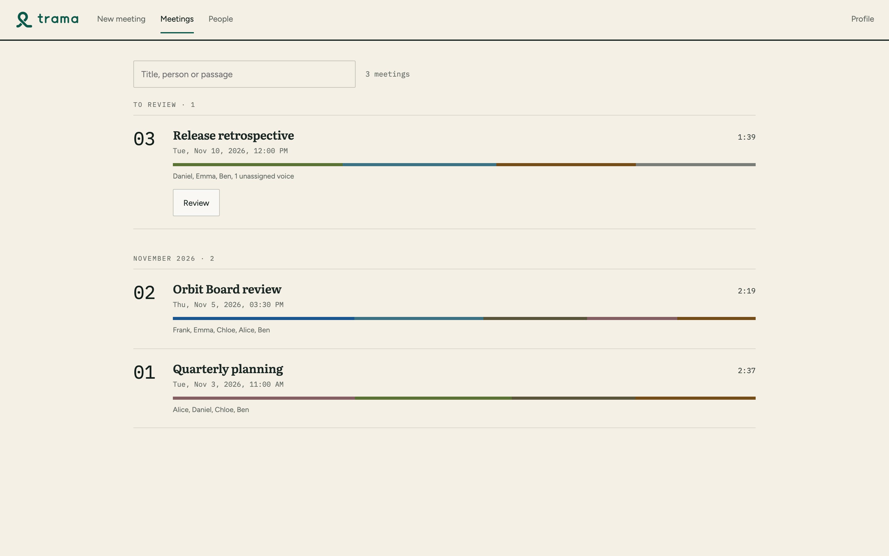
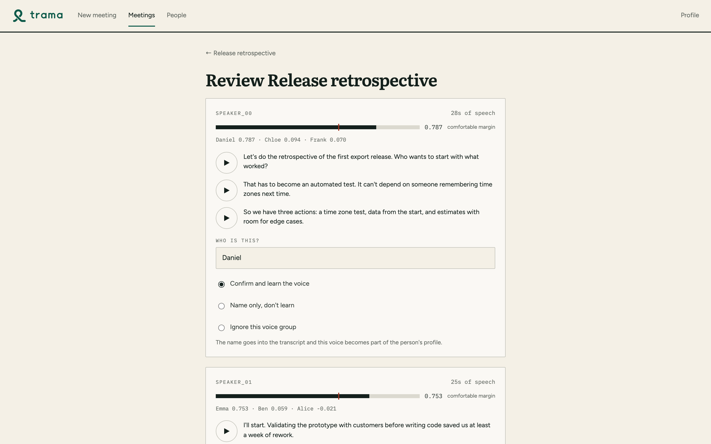
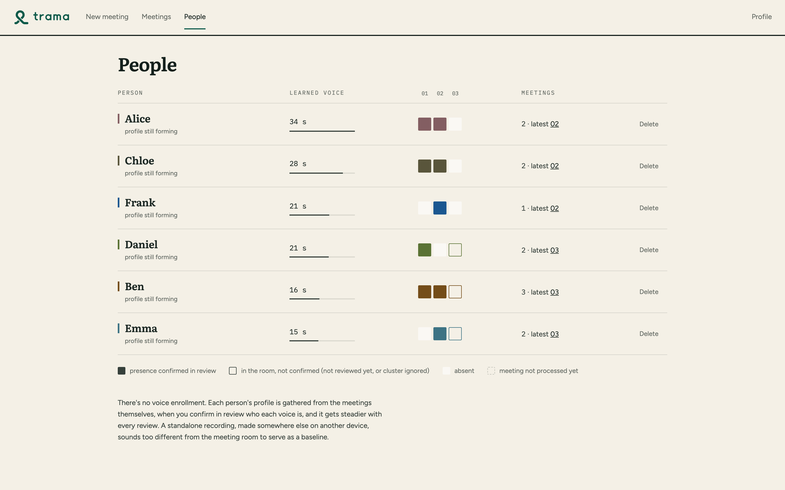
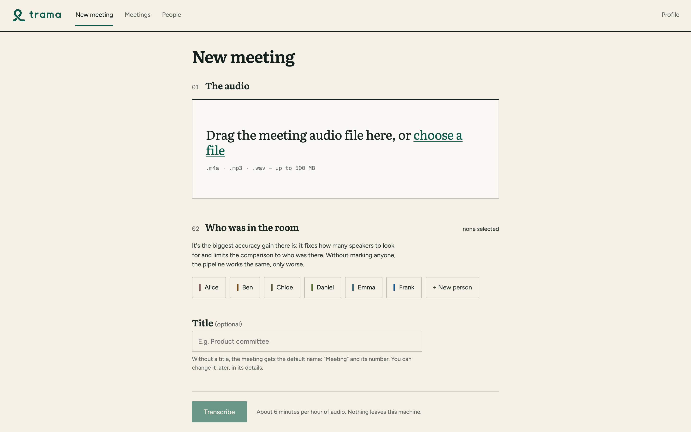

# Trama

[](https://github.com/Cesar-Azeredo/trama/actions/workflows/ci.yml)

**Who said what, in an in-person meeting — transcribed entirely on your own machine.**

Trama turns the recording of a meeting (a phone on the table) into a
transcript where every passage carries the name of the person who said it.
It learns each person's voice from the meetings themselves, so it gets
better with every meeting you review — and no audio, transcript or voice
profile ever leaves the computer.

<picture>
  <source media="(prefers-color-scheme: dark)" srcset="docs/capturas/detalhe-escuro.png">
  
</picture>

## The problem

Many companies cannot send meeting audio to a cloud service: legal,
finance, healthcare, anything under NDA or data-protection rules. The
local options transcribe well but answer the wrong question. A wall of
text with `SPEAKER_00` and `SPEAKER_01` is not a record of a meeting —
the value is in **who said what**: who committed to the deadline, who
raised the risk, who interrupted whom.

## What it does differently

- **Speaker identification that learns across meetings.** Speakers are
  separated (diarization) and each voice cluster is compared against a
  gallery of voice profiles. The gallery is not filled by a separate
  enrollment recording ([ADR 0011](docs/adr/0011-sem-cadastro-por-gravacao-avulsa.md)):
  it is harvested from the meetings themselves, when you confirm in about
  twenty seconds who each voice was. The next meeting comes out with the
  names already filled in.
- **Every learned second of voice is traceable and reversible.** Each
  confirmation is stored as one contribution per meeting and cluster, so
  re-reviewing a meeting replaces its contribution instead of inflating the
  profile, renaming moves it, and deleting a person removes everything
  learned about them ([ADR 0006](docs/adr/0006-migracoes-versionadas.md)).
- **100% offline.** Local models, a FastAPI server bound to `127.0.0.1`
  only, no telemetry, no CDN, no remote fonts, no update checks. Logs never
  contain what people said.
- **Honest about uncertainty.** Low-confidence words, gaps where someone
  spoke but nothing was transcribed, and words whose speaker disagrees with
  the sentence they belong to are shown as *hints*, never silently
  "corrected" ([ADR 0009](docs/adr/0009-atribuicao-por-palavra.md),
  [ADR 0010](docs/adr/0010-confianca-e-lacunas-por-fala.md)).
- **Conversation dynamics.** Share of speech, overlaps, interruptions and
  back-channels ("uh-huh") per person, measured from the overlapping
  diarization that most pipelines throw away.
- **Company vocabulary without a dictionary.** Fix a misheard product name
  once, in the text, and Trama finds the other ways the transcriber wrote
  it across all meetings — using edit distance, a Portuguese phonetic key
  and word frequency in your own meetings to avoid suggesting common words
  ([ADR 0020](docs/adr/0020-variacoes-parecidas-sem-dicionario.md)).

## Screenshots

Taken from the bundled demo data (fictional company, people and
conversations — see [Running the demo](#running-the-demo)). Each image
follows your GitHub light/dark theme; both versions are in
[`docs/capturas/`](docs/capturas/).

| Meetings | Review: who is each voice? |
|---|---|
| <picture><source media="(prefers-color-scheme: dark)" srcset="docs/capturas/lista-escuro.png"></picture> | <picture><source media="(prefers-color-scheme: dark)" srcset="docs/capturas/revisao-escuro.png"></picture> |

| People: voice learned per meeting | New meeting |
|---|---|
| <picture><source media="(prefers-color-scheme: dark)" srcset="docs/capturas/pessoas-escuro.png"></picture> | <picture><source media="(prefers-color-scheme: dark)" srcset="docs/capturas/nova-reuniao-escuro.png"></picture> |

## How it works

```
recording (.m4a)
  │
  ├─ 1. convert ............ ffmpeg → 16 kHz mono
  ├─ 2. diarize ............ pyannote speaker-diarization-community-1
  │                          (exclusive AND overlapping versions)
  ├─ 3. identify ........... one voice embedding per cluster, cosine
  │                          similarity + margin against the voice gallery
  ├─ 4. interaction ........ overlaps, interruptions, back-channels
  └─ 5. transcribe ......... Whisper (mlx-whisper on Apple Silicon,
                             faster-whisper elsewhere) → word-level
                             alignment → one speaker per sentence by
                             duration-weighted vote → company glossary
  ↓
reuniao_NN.json   ← the single source of truth the UI reads
  ↓
review (CLI or UI) → confirms names → voice gallery learns (SQLite ledger)
```

- **Pipeline and library:** Python package [`trama/`](trama/) —
  [`pipeline.py`](trama/pipeline.py) (the five steps),
  [`nucleo.py`](trama/nucleo.py) (embeddings and the voice database),
  [`revisao.py`](trama/revisao.py) (review and learning, shared by the CLI
  and the UI), [`interacao.py`](trama/interacao.py) (conversation dynamics).
- **Server:** FastAPI in [`trama/servidor/`](trama/servidor/), a thin shell
  over the `.json` files and the voice database; it never re-implements the
  pipeline and runs it as a subprocess so a GPU crash cannot take the app
  down ([ADR 0004](docs/adr/0004-servidor-local-fastapi.md)).
- **Frontend:** React + TypeScript + Vite, no component library, own visual
  identity; fonts bundled as files ([`frontend/`](frontend/)).
- **Voice database:** SQLite with versioned migrations and an automatic
  backup before each one ([ADR 0006](docs/adr/0006-migracoes-versionadas.md)).

On an Apple Silicon laptop, a 70-minute meeting takes about six minutes.

The full design, with where each threshold came from, is in
[`ARCHITECTURE.md`](ARCHITECTURE.md) (Portuguese).

## Technical decisions worth reading

Every decision with a discarded alternative has an Architecture Decision
Record in [`docs/adr/`](docs/adr/). A few that shaped the product:

| Decision | Why it is interesting |
|---|---|
| [0001 — identify per cluster, independently](docs/adr/0001-identificacao-por-cluster.md) | Optimal one-to-one assignment (Hungarian) was tried and dropped: diarization often splits one person into several clusters, and forcing exclusivity put the right name on one and a wrong name on the others. |
| [0011 — no voice enrollment from a separate recording](docs/adr/0011-sem-cadastro-por-gravacao-avulsa.md) | An embedding captures the room and the microphone together with the voice; a sample recorded at home matches worse than the meeting itself. |
| [0009 — word-level attribution is a hint, not a correction](docs/adr/0009-atribuicao-por-palavra.md) | Where the per-word speaker disagrees with the sentence vote, the UI marks it; changing the text automatically would be wrong more often than right. |
| [0010 — confidence and gaps per utterance](docs/adr/0010-confianca-e-lacunas-por-fala.md) | Measured, not guessed: why a per-utterance average hides a local error in a long turn, and why one-word utterances are excluded from the flag. |
| [0006 — versioned schema migrations](docs/adr/0006-migracoes-versionadas.md) | Voice profiles are biometric data; a migration that loses them is not an option. |
| [0020 — suggest variants without a dictionary](docs/adr/0020-variacoes-parecidas-sem-dicionario.md) | No Portuguese dictionary can be downloaded offline, so "common word" is measured from the user's own meetings. |
| [0003 — three confidentiality levels, no false promises](docs/adr/0003-confidencialidade-e-ata.md) | What "local" really guarantees, and what it does not. |
| [0025 — the `trama` package and synthetic demo data](docs/adr/0025-pacote-trama-e-repositorio-de-portfolio.md) | How the repository was reorganized and why the demo is generated by the real pipeline functions instead of anonymized real meetings. |

## Why the code is in Portuguese

Trama is a product for Brazilian companies. The code uses the vocabulary of
its domain in Portuguese — `reuniao` (meeting), `falante` (speaker),
`revisao` (review), `fala` (utterance) — the same words the users and the
product owner use, so a conversation about a bug maps directly onto the
code. Comments, ADRs and the architecture document follow the same
language. Identifiers have no accents (`interacao`, `sobreposicao`);
user-facing text does. This README and the repository description are in
English for a wider audience.

## Running the demo

The demo uses three fictional meetings in [`audios-demo/en/`](audios-demo/en/)
and a voice database with fictional profiles, generated by
[`ferramentas/gerar_demo.py`](ferramentas/gerar_demo.py) — no real audio,
no real people. A Portuguese set with the same structure is in
[`audios-demo/pt/`](audios-demo/pt/). It needs no Hugging Face token and
downloads no model.

Requirements: Python 3.12+, Node 24, ffmpeg.

```bash
python -m venv .venv && source .venv/bin/activate
pip install -e ".[dev]"
(cd frontend && npm ci)

# terminal 1 - API in demo mode, on 127.0.0.1:8000
REC_MEET_DEMO=1 REC_MEET_AUDIOS=audios-demo/en \
VOZES_DB=audios-demo/en/vozes-demo.db REC_MEET_TERMOS=termos.exemplo.en.txt \
trama-servidor

# terminal 2 - the interface
cd frontend && npm run dev     # http://localhost:5173
```

There is no audio in the demo: the play buttons say so.

## Running on real meetings

You also need a [Hugging Face](https://huggingface.co/) token that has
accepted the terms of `pyannote/speaker-diarization-community-1` and
`pyannote/wespeaker-voxceleb-resnet34-LM` (exported as `HF_TOKEN`; the
models are downloaded once and then run offline).

```bash
trama-verificar                       # checks ffmpeg, packages, token, model access
cp termos.exemplo.txt termos.txt      # your company glossary (kept out of git)
trama-processar audios/reuniao_01/reuniao_01.m4a --pessoas Ana,Bruno,Carla
trama-revisar audios/reuniao_01/reuniao_01.json   # or review in the UI
trama-servidor
```

The complete manual (Portuguese) is in [`docs/uso.md`](docs/uso.md).

## Tests and quality

```bash
pytest -q                                     # Python: 372 tests
for f in tests/test_*.py; do python "$f" | tail -1; done   # same suites, one by one
ruff check . && ruff format --check .
(cd frontend && npm test && npx oxlint && npm run build)   # 35 frontend tests
```

The Python suites stub out torch/pyannote where a model would be loaded,
generate synthetic audio with ffmpeg where a file is needed, and never
touch the real `audios/` folder or voice database. CI runs all of them,
plus the frontend lint, tests and build, on every push.

## Third-party models and libraries

Trama uses these components unmodified. Each keeps its own license; the
full attribution required by them is in [`ATRIBUICAO.md`](ATRIBUICAO.md).

| Component | Use | License |
|---|---|---|
| [pyannote/speaker-diarization-community-1](https://huggingface.co/pyannote/speaker-diarization-community-1) | diarization | CC-BY-4.0 |
| [pyannote/wespeaker-voxceleb-resnet34-LM](https://huggingface.co/pyannote/wespeaker-voxceleb-resnet34-LM) | voice embeddings | CC-BY-4.0 |
| [pyannote.audio](https://github.com/pyannote/pyannote-audio) | model runtime | MIT |
| [Whisper](https://github.com/openai/whisper) (via mlx-whisper or faster-whisper) | transcription | MIT |
| Literata, IBM Plex Mono, Figtree | interface fonts, bundled | SIL OFL 1.1 |

## License

Trama is **source-available** under the
[PolyForm Noncommercial License 1.0.0](LICENSE): you may read, run, study
and modify it for noncommercial purposes. Commercial use requires a
separate license — contact cesarazeredo@protonmail.com.

The license covers only the code in this repository. The models and
libraries above are governed by their own licenses (see
[`ATRIBUICAO.md`](ATRIBUICAO.md)).
